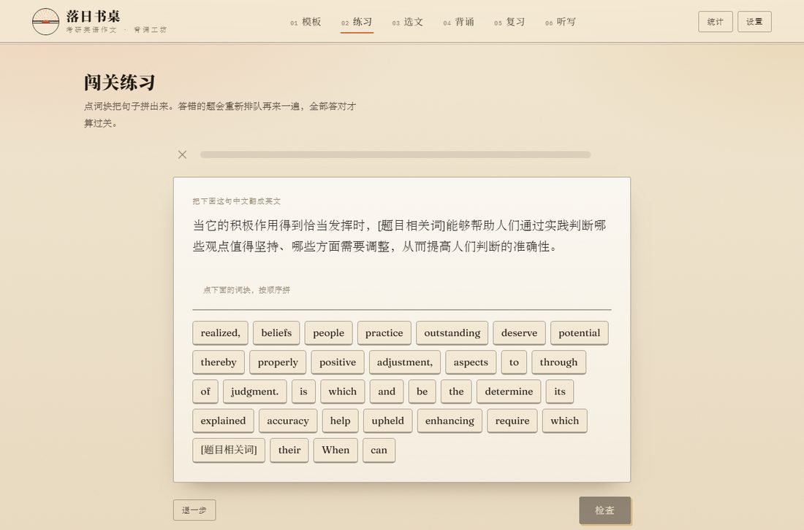

# 落日书桌 · 英语一作文背诵

纯静态的考研英语一作文背诵网站。没有后端、不用装依赖，双击 `index.html` 就能用，也可以直接丢到任何静态服务器上。

<p align="center">
  
</p>

打开就是「模板」页——里面全是我自己的东西，不是别人的范文。

## 里面有什么

| 页 | 内容 |
|---|---|
| **模板** | 大作文三段模板（10 句）+ 小作文句库（35 句 / 6 种信件类型），都能用两种模式背 |
| **练习** | 多邻国式闯关：点词块拼句子，答错清空重拼，连击计分 |
| 选文 | 3 组高频句型（开头 / 衔接 / 结尾）+ 「我的范文」入口 |
| 背诵 | 整句全挖空拼写 + 模糊显影，按 `1`–`2` 切换 |
| 复习 | 艾宾浩斯：当天 → 1 → 2 → 4 → 7 → 15 → 30 天 |

> 英语二图表作文已全部移除——只考英一，留着只是干扰。

## 闯关练习（多邻国式）



关键是**点词块拼句子**：给中文，把打乱的词块按顺序点成英文。这比「看着英文读」狠得多——它逼你回忆词序和结构，正是考场写句子的动作。

一轮 10 题，三种题型轮换：

| 题型 | 怎么玩 |
|---|---|
| 词块拼句 | 给中文 → 点词块拼英文（主题型） |
| 听音拼句 | 只给音频 → 听出来再拼（练听力 + 结构） |
| 四选一 | 给中文 → 从 4 句里挑出正确的那句 |

游戏机制：

- 顶部**进度条**，答一题走一格
- **连击**：连续答对累加，断了清零，最长连击会记下来
- **点词块就念这个词**（像多邻国那样跟着读），再点一次取消选择也会再念一遍
- **答对**：绿条 + 两声清脆音效，然后把**整句读一遍**
- **答错**：抖动音 + 红色提示，**已点的词块自动清空**，原地重新拼一次再检查，不用重开这道题
- **看答案**：卡住了可以摊开原句看一眼——但**这题不算过**，看完照样能把词块再拼一遍、再点检查；实在不想拼了点「跳过这题」
- 正确率按**第一次检查**算：一道题重拼多少次都不影响这一轮的分数
- 结算页：正确率、用时、最高连对、累计战绩

> 模板句里的 `[主体]`、`[动作/状态]` 这类方括号槽位，朗读时会**用中文音单独念出来**（`主体`、`动作`、`状态`），不会跟着英文音读成乱码，方括号本身也不会被念。

<p align="center">
  
</p>

题源可以选：大作文模板、小作文的六种信件、句型素材，一共 9 个入口。

### 随机 / 顺序

题源页顶部可以在两种出题方式之间切换，选择会记在本机：

| 方式 | 行为 |
|---|---|
| **随机**（默认） | 每轮从整个题源里随机抽 10 句，适合考前混练、查漏 |
| **顺序** | 按句库原本的顺序往下走，每轮 10 句，**练到哪记到哪**，下一轮自动接着上次的位置；走到末尾自动回到开头 |

顺序模式更适合一遍一遍过整份材料：卡片上会写「下次从第 N 句起」，答题页右上角标着这一轮覆盖的句子范围（如「顺序 11–20 / 35」）。想从头再来，点题源页右边的「从头开始」清零即可。两种方式共用同一套连击、结算和累计统计。

## 大作文模板

三段十句，`[方括号]` 是考场要现场替换的槽位：

| 段 | 句数 | 干什么 |
|---|---|---|
| 第一段 | 2 句 | 图片描述句 + 拔高到「价值与影响」的深层句 |
| 第二段 | 5 句 | 总起 → 变化从何而来 → 进入公众视野 → 积极作用 → 收束 |
| 第三段 | 3 句 | 下判断 + 社会层面 + 个人层面 |

每个槽位点一下会弹出「这里该填什么」；右上角能关中文、关提示做自测；按钮一键跳到背诵页。

## 小作文句库


35 句按「段落位置 × 信件类型」组织，**不是一篇死文章**：

```
首段第一句   → 私人书信 / 回信 / 正式书信 / 通知       （四选一）
首段第二句   → 谈事项 / 分享看法 / 明确目的 / 通知活动   （四选一）
第二段第一句 → 讲安排 / 摆观点 / 解释原因             （三选一）
第二段主体   → A建议信 3 句 · B邀请信 4 句 · C通知 3 句
               D道歉信 3 句 · E感谢信 3 句 · F介绍类 3 句
第三段结尾   → 期待回应 / 希望采纳 / 约定时间 / 提出要求
```

选一个类型（建议信 / 邀请信 / 通知 / 道歉信 / 感谢信 / 介绍类），页面自动从上往下各挑一条匹配句，拼成 6–8 句的完整小作文：

| 类型 | 句数 | 词数 |
|---|---|---|
| 建议信 | 7 | 100 |
| 邀请信 | 8 | 109 |
| 通知 | 7 | 93 |
| 道歉信 | 7 | 92 |
| 感谢信 | 6 | 76 |
| 介绍类 | 7 | 81 |

称呼（`Dear [称呼],`）和落款（`Yours sincerely, Li Ming`）按类型自动带上，通知则是 `NOTICE` + `The Students' Union`。拼好后点「背这一套」直接进两种模式。

页面底部有折叠的「全部 35 句」，想单刷句型、或看某类型还有哪些备选，展开就行。

## 两种背诵模式

| 键 | 模式 | 做什么 |
|---|---|---|
| `1` | 填空拼写 | **整句每个词都挖空**，在横线上手动打出来，打对变绿锁住并自动跳下一个空 |
| `2` | 模糊显影 | 英文糊住，点哪句哪句清晰 |

填空拼写是手打不是点选，而且不是「挑几个实词」——除了标点和 `[槽位]`，**每个词都是横线**，包括 the / a / of / is。打对了横线变绿并锁住，打错了标红抖动、可以接着改；大小写、标点、连字符都不影响判定。一句填完自动计入进度条。`Enter` 重判当前空，`Tab` 换到下一个空。光标停在横线里时，`1`–`2` 照样能切模式。

每句悬停有喇叭可单句朗读；语速和英美音在「设置」里调。带 `[槽位]` 的句子会把中文槽位单独用中文音念出来。

## 数据存在哪

进度存在**当前浏览器的 localStorage**（键名 `sunset-desk-v1`）。换电脑、换浏览器、清缓存都会丢：

- 设置 → **导出进度**，得到 JSON 文件；
- 新设备 设置 → **导入进度** 接着背。

## 加自己的范文

「选文」页底部「我的范文」里粘贴：

```
The Value of Reading
（空一行）
Reading is to the mind what exercise is to the body...
```

第一行当标题（也可以只贴正文），选好分类点「添加」。同样支持两种模式，卡片右上角 × 可删。

## 改模板和范文

都在 `data/essays.js`，两个东西：`window.ESSAYS`（范文）和 `window.TEMPLATES`（模板）。

**模板**分两种 `kind`：

- 不写 `kind`（大作文那种）：`sections[].sentences[]`，每句带 `hints` 说明槽位该填什么，另有 `essay` 字段供背诵页整篇背。
- `kind: "bank"`（小作文那种）：`groups[]` 是句子分组，每组标 `para`（属于第几段），主体组加 `multi: true` 表示「这个类型的所有句子都要」；每句的 `types` 决定它属于哪种信件，组内顺序就是该类型的首选顺序。

```js
{ en: "The purpose of this letter is to [动词] [题目关键词] (with you in detail).",
  cn: "这封信的目的是[动词][题目关键词]（视情况加 with you in detail）。",
  types: ["invitation"],
  tag: "明确目的",
  hints: { "动词": "如 invite you to / discuss / recommend" } }
```

加了新的 `types` 值记得同时写进 `types` 数组，否则类型按钮不会出现。

**范文**（如果以后要加）：

```js
{ id: "x-1", cat: "sent", tag: "开头 · 引出话题",
  title: "开头段万能句", prompt: "考场上紧张时可直接套用的开头",
  en: `英文，段落之间空一行。`,
  cn: ["逐句中文 1", "逐句中文 2", "..."] }
```

`cn` 和英文句子**逐句对齐**。改完跑一下自检脚本。

## 文件结构

```
index.html          页面骨架
css/style.css       全部样式
js/app.js           全部逻辑（切句、两种模式、模板拼装、闯关练习、复习调度、统计）
data/essays.js      范文 + 模板数据
preview/            README 里的截图
.shot/              自检脚本（跑测试用，不影响网站）
```

整个站没有构建步骤，`index.html / css / js / data` 四个东西拷到任何静态服务器的目录下就能跑。

## 自己跑一遍检查

```bash
python -m http.server 8779
node .shot/data-test.mjs     # 中文与英文句子是否逐句对齐
node .shot/qa.mjs            # 全站 84 项功能断言
node .shot/quiztest.mjs      # 闯关练习 53 项断言（含拼句、答错重拼再检查、顺序模式、结算）
```

三个脚本都需要本机装有 Edge（路径写在脚本顶部），跑完把截图丢到 `.shot/`（已被 `.gitignore` 忽略）。

## 部署

因为全是静态文件，随便放到哪都行；要让手机也能访问，见下面的做法。

### 1. GitHub Pages（最省事，免费）

```bash
# 仓库已推到 GitHub 后，在仓库 Settings → Pages
# Source 选 "Deploy from a branch"，Branch 选 main、目录选 /(root)，保存
# 一两分钟后访问 https://<你的用户名>.github.io/<仓库名>/
```

`.nojekyll` 已经放好，GitHub 不会再拿 Jekyll 处理这些文件。

### 2. 自己的服务器（nginx）

```bash
# 本地打包上传
rsync -avz --delete \
  --exclude '.git' --exclude '.shot' --exclude 'preview' \
  ./ user@your-server:/var/www/essay/
```

```nginx
server {
    listen 80;
    server_name essay.example.com;
    root /var/www/essay;
    index index.html;

    # 带 hash 的没做，就让 HTML 短缓存、静态资源中等缓存
    location = /index.html { add_header Cache-Control "no-cache"; }
    location ~* \.(css|js)$ { add_header Cache-Control "public, max-age=3600"; }
}
```

### 3. 就想自己看

直接双击 `index.html` 也行——数据是 `data/essays.js` 里的 JS 文件，不涉及 `fetch`，`file://` 下功能完整。

> 注意：不同浏览器、不同域名下 `localStorage` 是分开的。换地址访问等于从零开始背，换设备记得先在「设置 → 导出进度」备份。

## 一点使用建议

- **模板先背到脱口而出**，考场省下的时间全给填槽位和检查语法。
- 小作文按类型背熟 6–8 句就够，别背整篇——考场是往里填词，不是默写。
- 背完一定点「背下一篇」，忘了点就不会进入复习计划。
- 考前两周用「填空拼写」把整篇每个词都打一遍，能不看提示全打绿再换下一篇。
